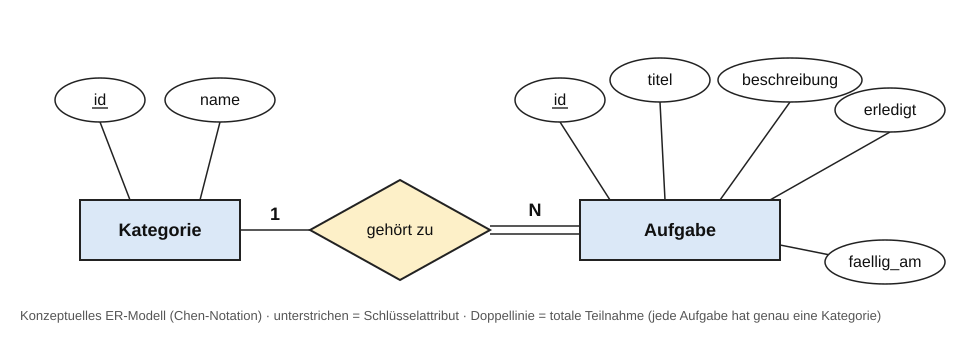

# Aufgabenverwaltung – Webbasierte Anwendungen

## Voraussetzungen

- Python 3.10 oder neuer
- MySQL-Server (z.B. MySQL Community Server), gestartet auf `localhost:3306`
- Internetverbindung (jQuery wird von code.jquery.com geladen)

## Datenbank einrichten

In `app/persistence.py` Benutzer und Passwort des MySQL-Servers eintragen:

```python
DB_USER = "root"
DB_PASSWORT = "passwort"
```

Die Datenbank `aufgaben` einmalig in MySQL anlegen (z.B. in MySQL Workbench):

```sql
CREATE DATABASE aufgaben;
```

Die Tabellen und die Kategorien (Schule, Arbeit, Privat) werden beim Start automatisch angelegt.

## Starten

```bash
python3 -m pip install -r requirements.txt
python3 main.py
```

Danach im Browser öffnen: http://localhost:8000
API-Dokumentation (automatisch von FastAPI): http://localhost:8000/docs

## ER-Modell (konzeptuell)



## REST-Service „Aufgabenverwaltung“

Beschreibung im gleichen Schema wie der Customer Management Service (Übung 1) und der Article Service (Übung 2). Alle Daten werden als JSON übertragen.

- **Liste aller Kategorien**
  - URL: `http://localhost:8000/api/kategorien`
  - Method: GET
  - Request Body: keiner
  - Response: Liste der Kategorien als JSON-Array (`id`, `name`)
- **Liste aller Aufgaben**
  - URL: `http://localhost:8000/api/aufgaben`
  - Method: GET
  - Query-Parameter (beide optional):
    - `kategorie_id` (Zahl): nur Aufgaben dieser Kategorie
    - `nur_offene` (`true`/`false`, Standard `false`): nur nicht erledigte Aufgaben
    - Beispiel: `http://localhost:8000/api/aufgaben?kategorie_id=2&nur_offene=true`
  - Request Body: keiner
  - Response: Liste der Aufgaben als JSON-Array, sortiert nach Fälligkeitsdatum (ohne Parameter: alle Aufgaben, unbekannte Kategorie: leere Liste)
- **Abfragen einer einzelnen Aufgabe**
  - URL: `http://localhost:8000/api/aufgabe/{ID}`
  - Method: GET
  - Request Body: keiner
  - Response: HTTP 200 mit der Aufgabe als JSON, HTTP 404 wenn die Aufgabe nicht gefunden wurde
- **Erstellen einer neuen Aufgabe**
  - URL: `http://localhost:8000/api/aufgabe`
  - Method: POST
  - Request Body: Aufgabe als JSON (Pflicht: `titel`, `kategorie_id`)
  - Response: HTTP 201 mit der neuen Aufgabe inkl. `id`, HTTP 400 bei ungültigen Daten (leerer Titel, unbekannte Kategorie, Datum in der Vergangenheit)
- **Mutieren einer Aufgabe**
  - URL: `http://localhost:8000/api/aufgabe/{ID}`
  - Method: PUT
  - Request Body: neue Version der Aufgabe als JSON
  - Response: HTTP 200 wenn geändert, HTTP 404 wenn die Aufgabe nicht gefunden wurde, HTTP 400 bei ungültigen Daten
- **Löschen einer Aufgabe**
  - URL: `http://localhost:8000/api/aufgabe/{ID}`
  - Method: DELETE
  - Request Body: keiner
  - Response: HTTP 200 wenn gelöscht, HTTP 404 wenn die Aufgabe nicht gefunden wurde

Aufbau einer Aufgabe:

```json
{
  "id": 1,
  "titel": "Hausaufgaben",
  "beschreibung": "Mathe Serie 3",
  "erledigt": false,
  "faellig_am": "2026-12-07",
  "kategorie_id": 1,
  "ueberfaellig": false
}
```

`ueberfaellig` wird vom Server berechnet und nicht gespeichert.

## Aufbau (Schichten)

| Datei | Schicht |
|---|---|
| `static/index.html`, `static/css/main.css`, `static/js/main.js` | Presentation Layer (HTML + CSS + JavaScript mit jQuery) |
| `app/service.py` | Web/REST Service Layer (REST-Endpunkte mit FastAPI) |
| `app/business.py` | Business Service Layer (DTOs + Business Services `AufgabeService`/`KategorieService` + Provider für `Depends`) |
| `app/persistence.py` | Persistence Layer (SQLAlchemy-Entitäten + DB-Verbindung) |
| `main.py` | Startpunkt, verbindet alles |
